# Exacta Community

**Bộ công cụ AI hỗ trợ nghiên cứu khoa học sức khỏe dựa trên bằng chứng, dành cho cộng đồng nghiên cứu Việt Nam.**

<!-- validator marker: badge/skills-25-0ea5e9 -->

`Mã nguồn mở · Apache-2.0` · `12 skill tiếng Việt` · `Chạy trên Claude Code` · `Dữ liệu ở lại trên máy bạn` · [English](README_EN.md)

Phát triển bởi **ThS. BS. Nguyễn Duy Toản** · [facebook.com/dutonezo](https://www.facebook.com/dutonezo)

*Exacta* — tiếng Latin nghĩa là "chính xác". Exacta là bộ skill cho trợ lý AI (Claude Code),
đồng hành cùng người nghiên cứu qua toàn bộ chu trình: xây dựng câu hỏi nghiên cứu, tìm và thẩm
định tài liệu, thiết kế đề cương, kiểm tra thống kê, trình bày số liệu, viết và chuyển ngữ bản
thảo, phản biện trước khi nộp và trình bày kết quả. Người dùng làm việc bằng tiếng Việt; sản phẩm
đạt chuẩn trình bày của tạp chí quốc tế và quy định trình bày trong nước.

## 1. Nguyên tắc khoa học

| Nguyên tắc | Exacta thực hiện như thế nào |
|---|---|
| **Dựa trên bằng chứng** | Chỉ sử dụng dữ kiện do tác giả cung cấp hoặc tài liệu đã thẩm định. Không tạo ra số liệu, tài liệu tham khảo, mã DOI hay số quyết định; thông tin còn thiếu được đánh dấu `[CẦN BỔ SUNG]`. |
| **Minh bạch, kiểm chứng được** | Mỗi trích dẫn kèm PMID/DOI và mức độ hỗ trợ cho luận điểm (trực tiếp, một phần, không hỗ trợ, mâu thuẫn). Mỗi công thức cỡ mẫu được trình bày đủ tham số và nguồn. |
| **Theo chuẩn báo cáo quốc tế** | Đối chiếu bản thảo với STROBE, CONSORT, STARD, CARE, PRISMA, TRIPOD; kiểm soát ngôn ngữ nhân quả theo đúng thiết kế nghiên cứu. |
| **Phù hợp bối cảnh Việt Nam** | Cấu trúc đề cương cấp cơ sở, luận văn thạc sĩ, CKI/CKII, BSNT; quy ước trình bày hình, bảng, số thập phân; bảng thuật ngữ y khoa Việt–Anh. |
| **Bảo mật dữ liệu người bệnh** | Bản thảo và dữ liệu không rời khỏi máy người dùng; tự rà thông tin định danh trước khi phân tích; truy cập mạng chỉ để tra cứu thư mục bằng từ khóa và mã định danh công khai. |

## 2. Hỗ trợ học thuật cho mọi người

| Đối tượng | Exacta hỗ trợ |
|---|---|
| Sinh viên Y, học viên sau đại học (thạc sĩ, CKI/CKII, BSNT, NCS) | Dàn ý đề cương, kiểm tra cỡ mẫu, tìm tài liệu, vẽ biểu đồ luận văn |
| Bác sĩ lâm sàng | Đọc nhanh và thẩm định bài báo, chuẩn bị journal club, viết bài báo từ dữ liệu thực hành |
| Giảng viên, người hướng dẫn | Rà soát đề cương và bản thảo của học viên theo tiêu chí thống nhất |
| Nhóm nghiên cứu | Tuyên bố dữ liệu, chuẩn bị nộp bài, phản biện thử, trả lời phản biện |

```mermaid
flowchart LR
    A["Câu hỏi nghiên cứu"] --> B["Tìm và thẩm định tài liệu<br/>exa-tim-tai-lieu"]
    B --> C["Đề cương<br/>exa-de-cuong"]
    C --> D["Thống kê, cỡ mẫu<br/>exa-thong-ke"]
    D --> E["Trình bày số liệu<br/>exa-ve-hinh"]
    E --> F["Viết và chuyển ngữ<br/>exa-viet-bai · exa-dich-thuat"]
    F --> G["Phản biện trước khi nộp<br/>exa-phan-bien"]
    G --> H["Nộp bài, phúc đáp<br/>exa-du-lieu · exa-phuc-dap"]
    H --> I["Trình bày kết quả<br/>exa-trinh-chieu"]
```



Ở mọi bước, `exa-doc-song-ngu` (đọc song ngữ Anh–Việt) và `exa-doc-sau` (thẻ đọc sâu) hỗ trợ
đọc và thẩm định tài liệu.

## 3. Bắt đầu

1. Cài [Git](https://git-scm.com/) và [Claude Code](https://claude.com/claude-code).
2. Tải Exacta Community và cài skill (Windows):

   ```bash
   git clone https://github.com/Toannd8194/Exacta-Community.git exacta
   ```

   ```bash
   powershell -ExecutionPolicy Bypass -File exacta/scripts/vn-install-skills.ps1
   ```

   macOS/Linux: `bash exacta/scripts/vn-install-skills.sh`

3. Mở phiên Claude Code mới trong thư mục đề tài và ra lệnh bằng tiếng Việt:

| Mục đích | Câu lệnh mẫu |
|---|---|
| Chiến lược tìm kiếm | `Dùng exa-tim-tai-lieu xây dựng chiến lược PubMed/MeSH cho câu hỏi: ...` |
| Kiểm tra cỡ mẫu | `Dùng exa-thong-ke kiểm tra công thức cỡ mẫu trong de-cuong.md.` |
| Dàn ý đề cương | `Dùng exa-de-cuong lập dàn ý đề cương luận văn thạc sĩ về ...` |
| Vẽ biểu đồ | `Dùng exa-ve-hinh vẽ biểu đồ Kaplan–Meier cho luận văn.` |
| Phản biện thử | `Dùng exa-phan-bien phản biện bản thảo này như reviewer tạp chí quốc tế.` |

Cần hỗ trợ cài đặt? Liên hệ người phát triển ở mục 5.

## 4. Bảo mật và liêm chính khoa học

- Không gửi bản thảo, dữ liệu, thư phản biện hay thông tin người bệnh ra dịch vụ bên ngoài.
- Không sử dụng API sinh ảnh, OCR hay tích hợp nhắn tin của bên thứ ba; không chạy tự động
  theo lịch, không tự cập nhật.
- Tài liệu chỉ được trích dẫn sau khi đã đọc phần tóm tắt; tài liệu không xác minh được được
  báo cáo rõ, không được "chỉnh sửa cho khớp".
- Toàn bộ quy tắc nằm trong [AGENTS.md](AGENTS.md) và được nạp tự động ở mỗi phiên làm việc.

## 5. Người phát triển, hỗ trợ và Exacta Pro

**ThS. BS. Nguyễn Duy Toản** phát triển và duy trì Exacta, hướng tới một công cụ nghiên cứu
chính xác, minh bạch và dễ tiếp cận cho người làm khoa học sức khỏe Việt Nam.
Liên hệ: [facebook.com/dutonezo](https://www.facebook.com/dutonezo)

- **Hỗ trợ cài đặt:** người phát triển có thể hỗ trợ cài đặt và hướng dẫn sử dụng bản Community.
- **Exacta Pro** dành cho cá nhân và đơn vị có nhu cầu hỗ trợ cao: khoa phòng, bệnh viện,
  trường đại học, nhóm nghiên cứu. Bản Pro gồm đầy đủ mọi chế độ của 12 skill, tùy biến theo
  quy định trình bày của từng đơn vị, cài đặt, đào tạo và hỗ trợ vận hành, với chi phí nhỏ.

Bản Community đáp ứng đầy đủ công việc hằng ngày của một người. Những chế độ sau thuộc bản Pro:

| Skill | Bản Community | Bổ sung ở bản Pro |
|---|---|---|
| `exa-de-cuong` | Dàn ý chi tiết, bảng đối chiếu mục tiêu – thiết kế – cỡ mẫu | Soạn toàn văn, rà soát, luận án tiến sĩ, hồ sơ đạo đức, mẫu riêng từng đơn vị |
| `exa-phan-bien` | Một báo cáo phản biện đầy đủ | Ba phản biện độc lập, tổng hợp, kiểm tra số liệu chuyên sâu |
| `exa-phuc-dap` | Phân loại toàn bộ ý kiến, trả lời tối đa 5 ý kiến mỗi lần | Trọn bộ thư phúc đáp và thư gửi biên tập |
| `exa-trinh-chieu` | Dàn ý slide kèm lời thuyết trình | File PPTX hoàn chỉnh, khung bảo vệ đề cương/luận văn/luận án |
| Các skill khác | Đầy đủ chức năng chính | Một số chế độ nâng cao (xử lý theo lô, phân tích dữ liệu thô, sơ đồ CONSORT...) |

## 6. Danh mục skill

| Skill | Công dụng |
|---|---|
| [`exa-de-cuong`](skills/exa-de-cuong/README.md) | Dàn ý đề cương, luận văn (bản giới hạn) |
| [`exa-dich-thuat`](skills/exa-dich-thuat/README.md) | Dịch Việt → Anh, chuốt văn học thuật |
| [`exa-doc-sau`](skills/exa-doc-sau/README.md) | Thẻ đọc sâu, khả năng áp dụng tại Việt Nam |
| [`exa-doc-song-ngu`](skills/exa-doc-song-ngu/README.md) | Đọc bài báo song ngữ Anh–Việt |
| [`exa-du-lieu`](skills/exa-du-lieu/README.md) | Tuyên bố dữ liệu, quản lý dữ liệu |
| [`exa-phan-bien`](skills/exa-phan-bien/README.md) | Phản biện thử trước khi nộp (bản giới hạn) |
| [`exa-phuc-dap`](skills/exa-phuc-dap/README.md) | Trả lời phản biện (bản giới hạn) |
| [`exa-thong-ke`](skills/exa-thong-ke/README.md) | Thống kê và cỡ mẫu |
| [`exa-tim-tai-lieu`](skills/exa-tim-tai-lieu/README.md) | PubMed/MeSH, trích dẫn, xuất RIS |
| [`exa-trinh-chieu`](skills/exa-trinh-chieu/README.md) | Dàn ý slide (bản giới hạn) |
| [`exa-ve-hinh`](skills/exa-ve-hinh/README.md) | Kaplan–Meier, forest plot, ROC |
| [`exa-viet-bai`](skills/exa-viet-bai/README.md) | Viết bài báo tiếng Anh |

<details>
<summary><b>Bộ máy nền</b> — 13 skill được các skill <code>exa-*</code> tự gọi, bạn không cần gọi trực tiếp</summary>

| Skill | Vai trò |
|---|---|
| [`nature-academic-search`](skills/nature-academic-search/README.md) | Tìm kiếm đa nguồn, MeSH |
| [`nature-citation`](skills/nature-citation/README.md) | Trích dẫn trong họ Nature/CNS |
| [`nature-data`](skills/nature-data/README.md) | Tuyên bố dữ liệu |
| [`nature-figure`](skills/nature-figure/README.md) | Vẽ hình Python/R |
| [`nature-paper-card`](skills/nature-paper-card/README.md) | Thẻ đọc bài báo |
| [`nature-paper-xray`](skills/nature-paper-xray/README.md) | Phân tích sâu một bài báo |
| [`nature-paper2ppt`](skills/nature-paper2ppt/README.md) | Bài báo thành slide |
| [`nature-polishing`](skills/nature-polishing/README.md) | Chuốt văn tiếng Anh |
| [`nature-reader`](skills/nature-reader/README.md) | Bản đọc song ngữ |
| [`nature-response`](skills/nature-response/README.md) | Trả lời phản biện |
| [`nature-reviewer`](skills/nature-reviewer/README.md) | Phản biện độc lập |
| [`nature-statistics`](skills/nature-statistics/README.md) | Báo cáo thống kê |
| [`nature-writing`](skills/nature-writing/README.md) | Soạn bản thảo |

</details>

## 7. Đóng góp

Mọi góp ý và đóng góp đều được hoan nghênh qua Issue và Pull Request. Quy tắc đóng góp nằm trong
[AGENTS.md](AGENTS.md): thêm nội dung dưới dạng file mới (`skills/exa-*`,
`skills/nature-shared/vn/`), không sửa file của bộ máy nền, chạy các script kiểm tra trước khi
gửi (lệnh đầy đủ trong [README_EN.md](README_EN.md) mục 7). Các thành phần đã loại bỏ khỏi bộ máy
nền được liệt kê tại [frozen/FROZEN.md](frozen/FROZEN.md).

## 8. Giấy phép

Apache-2.0 — tự do sử dụng, sửa đổi và phân phối lại. Exacta được phát triển trên nền dự án mã
nguồn mở [Nature Skills](https://github.com/Yuan1z0825/nature-skills) của Yuan Yizhe và cộng sự;
thông báo bản quyền gốc được giữ nguyên trong [LICENSE](LICENSE).
